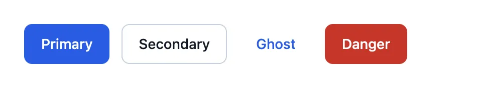
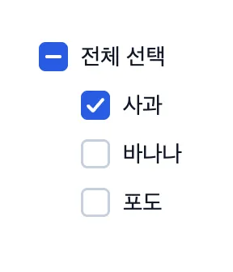
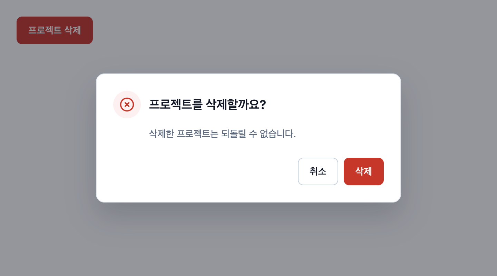
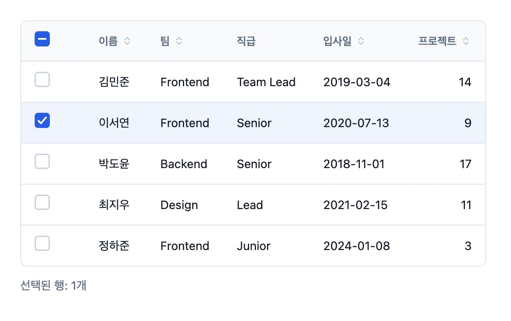
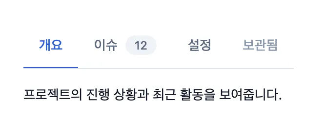
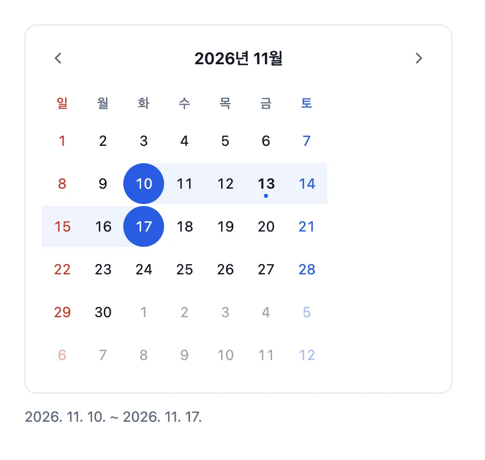
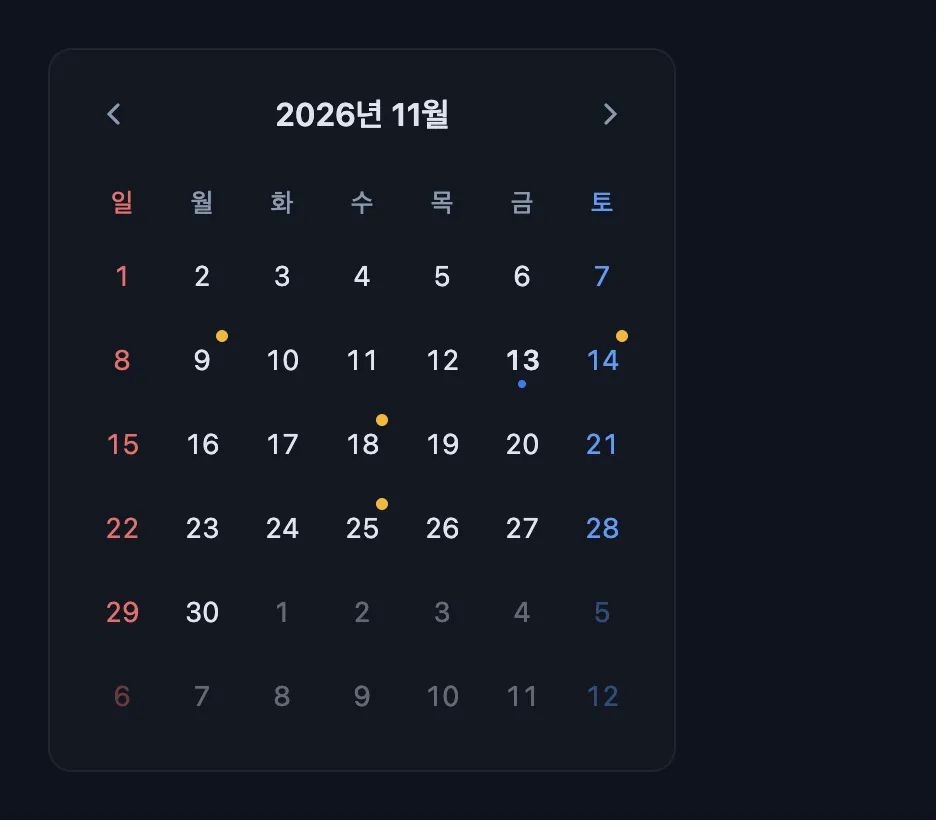

<div align="center">

# module-design-system

**React 프로젝트에 붙여 쓰는 컴포넌트 디자인 시스템**

디자인 토큰 하나로 브랜드와 다크 테마를 바꾸고, Storybook에서 모든 컴포넌트를 바로 확인합니다.

### 🔗 Storybook: __STORYBOOK_URL__


</div>

## 특징

- **디자인 토큰 기반:** 모든 색·간격·모서리·글꼴이 `--ds-` CSS 변수입니다. 변수만 바꾸면 브랜드 테마가 적용됩니다.
- **라이트 / 다크 테마:** `<html data-theme="dark">` 하나로 전환합니다.
- **접근성:** 키보드 조작, 포커스 링, ARIA 속성(`role`, `aria-selected`, `aria-sort` 등)을 기본으로 갖췄습니다.
- **외부 의존성 없음:** React 외의 런타임 라이브러리를 쓰지 않습니다. 빌드 결과는 JS 약 18KB, CSS 약 15KB입니다.
- **TypeScript:** 모든 props에 타입과 설명이 있어 에디터 자동완성으로 바로 쓸 수 있습니다.

## 컴포넌트

### Button



용도에 따라 강조 수준을 고르는 기본 버튼입니다.

- `variant`: `primary` · `secondary` · `ghost` · `danger`
- `size`: `sm` · `md` · `lg`
- `loading`이면 스피너를 보여주고 클릭을 막습니다. `leftIcon` / `rightIcon`으로 아이콘을 붙입니다.

```tsx
<Button variant="primary" leftIcon={<PlusIcon />}>새로 만들기</Button>
<Button variant="danger" loading>삭제 중</Button>
```

### Checkbox



라벨·보조 설명·오류 메시지를 함께 보여주는 체크박스입니다. `indeterminate`로 '일부 선택' 상태를 표시할 수 있어 전체 선택 UI에 씁니다.

```tsx
<Checkbox label="전체 선택" checked={all} indeterminate={some} onChange={toggleAll} />
<Checkbox label="마케팅 수신 동의" description="이벤트 소식을 이메일로 받습니다." />
```

### MessageBox



확인/취소를 묻는 모달 대화상자입니다. 브라우저 기본 `<dialog>`를 사용해 포커스가 대화상자 안에 머물고, Esc나 배경 클릭으로 닫힙니다.

- `tone`: `info` · `success` · `warning` · `danger` (아이콘 색과 확인 버튼 스타일이 바뀝니다)
- `confirmLoading`: 서버 요청 중에는 버튼에 로딩을 표시하고 닫기를 막습니다.
- `cancelText={null}`이면 확인 버튼만 있는 알림창이 됩니다. `footer`로 버튼 영역을 직접 그릴 수 있습니다.

```tsx
<MessageBox
  open={open}
  onClose={() => setOpen(false)}
  tone="danger"
  title="프로젝트를 삭제할까요?"
  confirmText="삭제"
  onConfirm={handleDelete}
>
  삭제한 프로젝트는 되돌릴 수 없습니다.
</MessageBox>
```

### Table



컬럼 정의만 넘기면 정렬·행 선택·빈 상태를 처리해 주는 테이블입니다.

- 헤더를 누르면 오름차순 → 내림차순 → 정렬 해제 순으로 바뀝니다. 한글은 가나다순으로 비교합니다.
- `selectable`이면 체크박스 열이 생기고, 전체 선택은 일부 선택 상태까지 표시합니다.
- 컬럼의 `render`로 배지·버튼 같은 셀 내용을 직접 그립니다.

```tsx
const columns: TableColumn<Member>[] = [
  { key: 'name', header: '이름', sortable: true },
  { key: 'projects', header: '프로젝트', sortable: true, align: 'right', render: (r) => `${r.projects}건` },
];

<Table columns={columns} data={members} rowKey="id" selectable selectedKeys={keys} onSelectionChange={setKeys} />
```

### Tabs



`Tabs` · `TabList` · `Tab` · `TabPanel`을 조합해 쓰는 탭입니다.

- `variant`: `line` · `pill`
- 화살표 키와 Home/End로 탭을 이동하고, 비활성 탭은 건너뜁니다.
- `badge`로 개수 표시, `keepMounted`로 숨긴 패널의 상태를 유지합니다.

```tsx
<Tabs defaultValue="overview">
  <TabList aria-label="프로젝트 메뉴">
    <Tab value="overview">개요</Tab>
    <Tab value="issues" badge={12}>이슈</Tab>
  </TabList>
  <TabPanel value="overview">...</TabPanel>
  <TabPanel value="issues">...</TabPanel>
</Tabs>
```

### Calendar

<table>
  <tr>
    <td width="50%"><p align="center"><b>기간 선택</b></p></td>
    <td width="50%"><p align="center"><b>다크 테마 · 일정 표시</b></p></td>
  </tr>
</table>

날짜 하나 또는 기간을 고르는 달력입니다. 외부 날짜 라이브러리를 쓰지 않습니다.

- `mode`: `single`(날짜 하나) · `range`(시작일과 종료일). 기간 모드에서는 마우스를 올린 날짜까지 미리 보여줍니다.
- `minDate` · `maxDate` · `isDateDisabled`로 고를 수 있는 날짜를 제한합니다.
- `weekStartsOn`으로 주 시작 요일을, `locale`로 표기 언어를 바꿉니다. 기본은 한국어입니다.
- 키보드: 화살표(하루·한 주), Home/End(주의 처음·끝), PageUp/PageDown(한 달, Shift를 같이 누르면 1년)
- `renderDay`로 날짜 칸에 일정 점 같은 내용을 직접 그립니다.

```tsx
<Calendar mode="range" value={range} onChange={setRange} minDate={new Date()} />
```

## 프로젝트에 붙여 쓰기

### 1. 설치

```bash
# GitHub에서 바로 설치
npm install github:mixbyme/module-design-system

# 또는 로컬 폴더에서 설치 (이 저장소에서 먼저 npm run build)
npm install ../module-design-system
```

### 2. 스타일과 컴포넌트 불러오기

```tsx
// 앱 진입점 (main.tsx)에서 한 번만
import 'module-design-system/styles.css';
```

```tsx
import { Button, Calendar, MessageBox } from 'module-design-system';
```

글꼴과 기본 글자 색까지 맞추려면 앱 최상위 요소에 `className="ds-root"`를 붙입니다.

## 확장하기

### 브랜드 테마 바꾸기

모든 컴포넌트는 [tokens.css](src/tokens/tokens.css)의 `--ds-` 변수만 참조합니다. 사용하는 프로젝트에서 같은 변수를 다시 선언하면 됩니다.

```css
:root {
  --ds-color-primary: #7c3aed;
  --ds-color-primary-hover: #6d28d9;
  --ds-color-primary-subtle: #f5f3ff;
  --ds-radius-md: 4px;
}
```

다크 테마는 `<html data-theme="dark">`로 켭니다. 특정 영역에만 다른 테마를 주려면 그 요소에 `data-theme` 속성이나 변수를 선언합니다.

### 컴포넌트 커스터마이즈

- 모든 컴포넌트가 `className`과 기본 HTML 속성(`onClick`, `aria-*` 등)을 그대로 받습니다.
- `Button`, `Checkbox`는 `ref`를 전달해 폼 라이브러리와 연동할 수 있습니다.
- 클래스 이름은 `ds-컴포넌트__요소--상태` 규칙(BEM)이라 CSS로 덮어쓰기 쉽습니다.

### 새 컴포넌트 추가

1. `src/components/새컴포넌트/`에 `새컴포넌트.tsx`, `새컴포넌트.css`, `index.ts`, `새컴포넌트.stories.tsx`를 만듭니다.
2. CSS에서는 `tokens.css`의 변수만 사용합니다.
3. `src/styles.css`에 CSS를, `src/index.ts`에 export를 추가합니다.

## 개발

```bash
npm install
npm run storybook        # http://localhost:6006
npm run build            # dist/ 에 라이브러리 빌드 (JS + CSS + 타입)
npm run build-storybook  # storybook-static/ 에 정적 Storybook 빌드
npm run typecheck
```

Storybook 상단 툴바의 Theme 메뉴로 라이트/다크 테마를 바꿔볼 수 있습니다. `main` 브랜치에 푸시하면 Vercel이 Storybook을 자동으로 다시 배포합니다.

## 폴더 구조

```
.storybook/          Storybook 설정 (테마 전환 툴바)
docs/screenshots/    README용 캡처
src/
  tokens/tokens.css  디자인 토큰 (라이트/다크)
  components/        컴포넌트별 폴더 (tsx, css, stories, index)
  utils/cx.ts        클래스 이름 합치기 유틸
  styles.css         전체 스타일 진입점
  index.ts           패키지 진입점
vercel.json          Vercel 배포 설정 (Storybook 정적 빌드)
```
